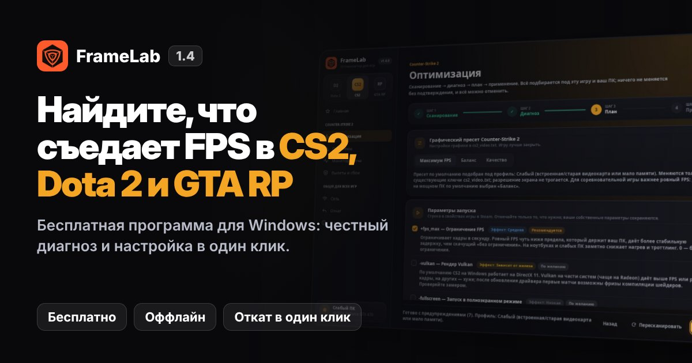
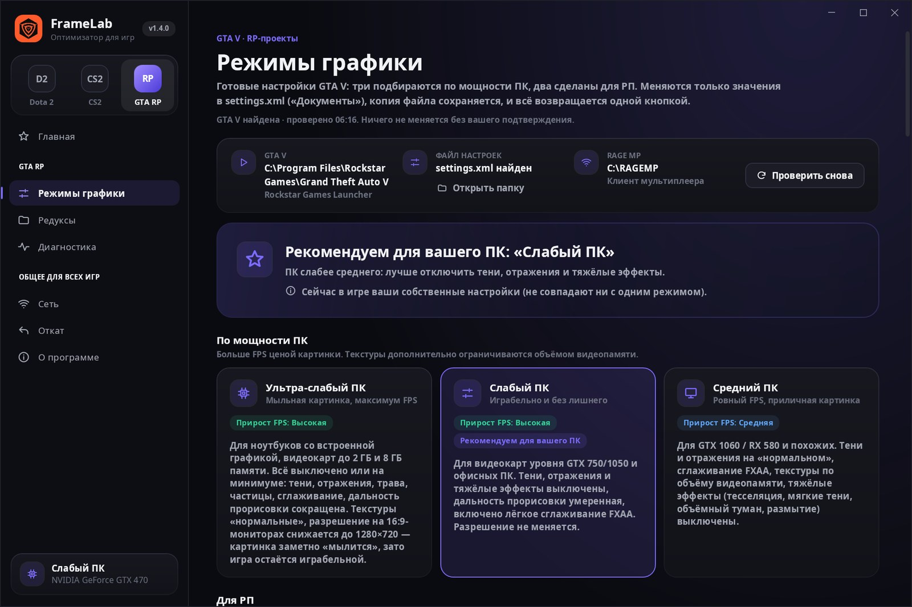
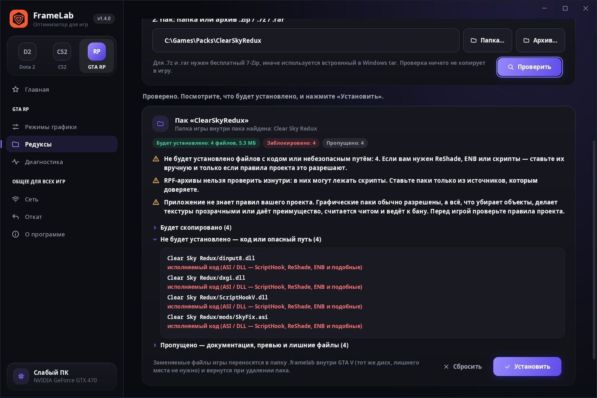
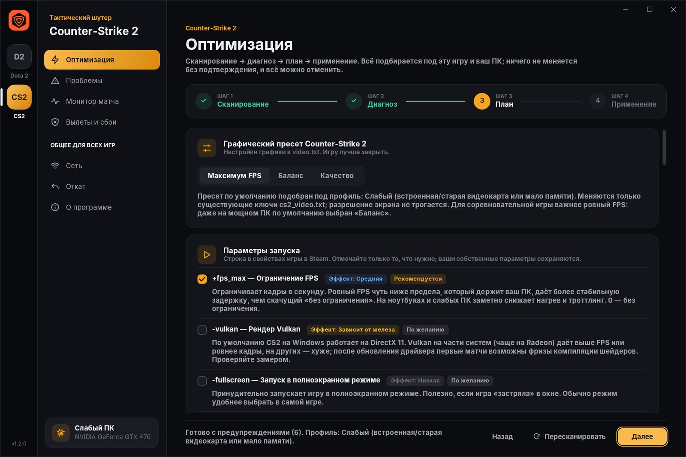

# FrameLab

[](https://github.com/Derposd/v60/releases/latest)
[](https://github.com/Derposd/v60/releases)


[](https://derposd.github.io/v60/)

|  |  |  |
|---|---|---|
| Режимы графики GTA 5 RP | Менеджер редуксов | План для CS2 |

**Гайды:** [FPS в GTA 5 RP на слабом ПК](https://derposd.github.io/v60/gta-5-rp/) · [как установить редукс](https://derposd.github.io/v60/reduksy-gta-5-rp/) · [задержка ввода в CS2](https://derposd.github.io/v60/cs2-input-lag/) · [FPS в Dota 2](https://derposd.github.io/v60/dota-2-fps/)

Оффлайн-утилита для Windows 10/11. Настраивает Windows под игры и отдельно — игры под видеокарты NVIDIA, AMD и Intel. Раздел слева выбирается переключателем:

- **ПК** (открывается при запуске) — Windows и другие игры: твики системы, интерфейса, приватности, служб, видеокарты и сети; игровой режим в реальном времени; автозагрузка; разовые ускорения; пресеты Fortnite, Valorant, Minecraft Java и Apex Legends; апскейл и генерация кадров; бенчмарк до/после.
- **Dota 2** и **Counter-Strike 2** — мастер оптимизации, база проблем, монитор матча и диагностика вылетов.
- **GTA RP** (GTA5RP, Majestic RP и другие) — режимы графики, менеджер редуксов и диагностика.

Сеть, откат, настройки и логи общие.

Раньше программа называлась Dota 2 Optimizer. Новая версия ставится поверх старой, бэкапы и история сохраняются.

## Скачать

Сайт программы: **https://derposd.github.io/v60/**

**[⬇ Скачать установщик (FrameLab-Setup.exe)](https://github.com/Derposd/v60/releases/latest/download/FrameLab-Setup.exe)**

1. Скачайте файл по ссылке выше и запустите его. Права администратора для установки не нужны.
2. Если Windows покажет «Windows защитила ваш компьютер», нажмите «Подробнее» → «Выполнить в любом случае». Так бывает с любой программой без платной цифровой подписи.
3. Запустите «FrameLab» из меню «Пуск», выберите игру слева и пройдите мастер: Сканирование → Диагноз → План → Применить.

Без установки: [FrameLab.exe](https://github.com/Derposd/v60/releases/latest/download/FrameLab.exe) (один файл, запускается сразу; PresentMon для записи FPS уже встроен). Все версии — на странице [релизов](https://github.com/Derposd/v60/releases).

- **Оффлайн.** Нет аккаунтов, телеметрии и автообновлений. Сеть используется только по кнопкам: тест сети и DNS, а также загрузка Magpie и OptiScaler с их официальных страниц на GitHub — каждый раз с вашего согласия.
- **Честно.** У каждого твика есть метка эффективности (Высокая / Средняя / Низкая / Зависит от железа), объяснение «что делает и зачем» и пометка «рекомендуется / по желанию». Спорные твики помечены и выключены по умолчанию.
- **Безопасно.** В процесс игры программа не вмешивается: не читает и не меняет её память, не делает инъекций. Единственное, что делается с процессом игры, — по желанию приоритет «Высокий» в игровом режиме (то же, что в Диспетчере задач; для Valorant пропускается). OptiScaler ставится только в одиночные игры: при найденном античите установка блокируется. Меняются только конфиги игры, настройки Windows и пользовательские настройки (VAC-безопасно). В GTA V не ставится никакой код: скрипты, ASI, DLL (ScriptHook, ReShade, ENB) менеджер редуксов блокирует всегда.
- **Обратимо.** Перед каждым шагом сохраняется копия файла или значения реестра (журнал пишется на диск *до* изменения). Рядом с каждым сделанным изменением есть кнопка «Отменить»: в карточке твика (шаг «План»), в отчёте после применения и у смены DNS. Плюс вкладка «Откат» с историей и «Откатить всё», и точка восстановления Windows. Dry-run включён по умолчанию.

## Что умеет

| Модуль | Что делает |
|---|---|
| ПК → Твики Windows | Переключатели с меткой эффекта и риска, описанием «что меняет и для каких игр», пометками «админ», «перезагрузка», «спорно». Включение — через превью всех изменений (и предложение точки восстановления перед первым применением), выключение — откат именно сохранённой копии. Система: игровой режим, Game DVR и захват Game Bar, HAGS, MPO, планы питания (в т.ч. «Максимальная производительность»), Power Throttling, MMCSS, Win32PrioritySeparation (спорно), таймер, USB. Интерфейс: визуальные эффекты, анимации, прозрачность, панель задач, Проводник. Приватность: веб-поиск Bing, виджеты, Copilot, Cortana, рекламный ID, советы и автоустановка приложений, рекомендации «Пуска», отзывы. Службы — в «Вручную», не удаляются: телеметрия, индексирование (только при HDD), диспетчер печати (только без принтера), карты. Видеокарта: NVIDIA — режим питания, низкая задержка, кэш шейдеров через профиль драйвера (каждый ID сверяется с драйвером по имени); AMD и Intel — точные шаги в их панелях. Сеть: свойства адаптера, только если их объявляет драйвер (Interrupt Moderation, EEE, Flow Control, буферы, RSC/LSO, роуминг Wi-Fi), TCP autotuning, BBR2, DSCP 46 по играм — с честным «эффект минимальный» там, где действует только TCP. Неподходящее железу скрыто. Профили «Игры» / «Работа» одной кнопкой. |
| ПК → Игровой режим | Пока идёт игра из списка (узнаёт популярные игры, можно добавить свою), закрывает выбранные фоновые программы, останавливает выбранные службы и ставит игре приоритет «Высокий»; после выхода всё возвращается. Состояние пишется на диск до каждого шага: после сбоя FrameLab возвращает всё при следующем запуске. Windows, голосовой чат, лаунчеры, античиты, звук, сеть, Защитник и Центр обновления не трогаются никогда. «Отключить оптимизацию во весь экран» для любой добавленной игры. |
| ПК → Автозагрузка | Как в Диспетчере задач: флаг StartupApproved, запись программы не удаляется; каждое изменение отменяется. |
| ПК → Ускорения | Разовые действия с честной пометкой: временные файлы, кэш DNS, кэш шейдеров, перезапуск Проводника, TRIM для SSD, очистка standby-памяти («обычно не нужно»). |
| ПК → Пресеты игр | Fortnite, Valorant, Minecraft Java, Apex Legends: «Максимум FPS» / «Баланс» через файл настроек; меняются только существующие ключи, копия файла сохраняется, игра должна быть закрыта. Где игра хранит настройки в облаке — сказано прямо. |
| ПК → Апскейл и кадры | «Что доступно на вашей карте»: DirectX feature level (D3D11CreateDevice), DX12 и таблица «работает / экспериментально / не работает» для оконного апскейла, Lossless Scaling, DLSS SR/FG/MFG, NIS, AFMF 2, RSR, XeSS, FSR 3/4 и FSR 3 FG, OptiScaler. Оконный апскейлер — Magpie: FrameLab по кнопке скачивает официальный релиз (проверка MD5), держит отдельную portable-копию и настраивает её: FSR 1, NIS, CAS, Lanczos, integer ×2, Anime4K × «Качество / Баланс / Производительность», профиль на exe, автозапуск масштабирования, выбор видеокарты на ноутбуке. Lossless Scaling — поиск в Steam, запуск и настройки под карту. OptiScaler — только одиночные игры с DLSS/FSR 2+/XeSS, официальный релиз по кнопке, файлы с бэкапом, «Удалить» возвращает папку игры. Предупреждения о задержке, запасе GPU и банах — вверху страницы. |
| ПК → Бенчмарк | 30/60/120 с через PresentMon + пинг: средний FPS, 1% и 0,1% low, время кадра, фризы; «до» и «после» с графиками и честным выводом (меньше 3% — погрешность). |
| Главная | Оптимизация в один клик: для всех установленных игр применяется только то, что мастер выбрал бы сам — рекомендованное, не спорное, без перезагрузки; перед этим показывается список, после — отчёт с «Отменить всё». «Ускорение на время игры»: пока идёт Dota 2 или CS2, включается план «Высокая производительность», после игры возвращается прежний (программы не закрываются). Фоновые программы, которые мешают игре прямо сейчас (только список). Очистка временных файлов старше суток. |
| 1. Определение системы | GPU через DXGI и WMI (производитель по PCI VEN_10DE/1002/8086, VRAM, версия и дата драйвера). Для гибридных ноутбуков показывает, на какой карте реально рендерится игра (по системным счётчикам «GPU Engine», как в Диспетчере задач). Также CPU, RAM (модули, вероятная двухканальность, частота), тип диска (HDD/SSD/NVMe), монитор, план питания, версия Windows, Steam (реестр, `libraryfolders.vdf`), Dota 2 (`appmanifest_570.acf`, `cfg`, `userdata`) и CS2 (`appmanifest_730.acf`, `userdata\<id>\730\local\cfg\cs2_video.txt`). По итогу — профиль ПК: слабый, средний или мощный. Результат сохраняется в `%LOCALAPPDATA%\Dota2Optimizer\last-scan.json`: при следующем запуске железо берётся из него, а Steam, игры, монитор и план питания перечитываются; полный скан повторяется сам, если сменилась видеокарта, драйвер или процессор либо скану больше 14 дней. |
| 2. Настройки игры | Пресеты «Максимум FPS / Баланс / Качество» для `video.txt` (Dota 2) и `cs2_video.txt` (CS2): меняются **только существующие** ключи, остальной текст файла сохраняется байт в байт. Предупреждение о Steam Cloud. Параметры запуска пишутся в `localconfig.vdf` только при закрытом Steam, иначе выдаётся строка для копирования. Советник DX11/Vulkan с инструкцией, как сравнить. |
| 3. Windows | План питания, игровой режим, фоновая запись Game Bar, предпочтение GPU для exe игры, оптимизация во весь экран (спорно), HAGS (только вручную), приоритет через IFEO (спорно). Только показ: фоновые программы, место на диске, файл подкачки, температура (если датчик доступен), энергосбережение USB и сетевой карты. |
| 4. Драйверы | Пошаговые инструкции для панели NVIDIA, AMD Adrenalin и Intel с учётом поколения карты, кнопка «Открыть панель». Профили драйвера программа не редактирует. |
| 5. Вылеты | Журнал Windows за 30 дней (1000/1001/1002, Display 4101, nvlddmkm, amdkmdag/amdwddmg, Kernel-Power 41, WHEA). Модуль сбоя переводится в понятную причину. Дампы, `console.log` и логи Steam. Очистка кешей шейдеров (Steam/DirectX/NVIDIA/AMD/Intel), `steam://validate/<appid>`, очистка кеша загрузки Steam — всё с подтверждением. Проверка VC++ 2015–2022, DirectX и Vulkan. Список известных конфликтов. |
| 6. Сеть | Пинг, потери и jitter до роутера, публичных DNS и релеев Valve SDR. Wi-Fi или кабель, уровень сигнала, фоновый трафик. Вердикт: проблема у вас, у провайдера или на маршруте/сервере. DNS меняется только по желанию и с откатом; сброс сетевого стека — с подтверждением. |
| Проблемы | Отдельная база для каждой игры. Dota 2: падение FPS к концу матча, фризы после обновления, микрофризы, чёрный экран, неверное разрешение, вылеты, лаги, зависшее обновление. Для каждого — причина, шаги и кнопки-исправления: сброс настроек графики, временное отключение autoexec.cfg, переключение DX11 ↔ Vulkan (все три обратимы и отменяются там же), очистка кеша шейдеров, проверка файлов. Показывает, сколько места заняли повторы и файлы Мастерской. CS2: просадки в дыму и перестрелках, фризы после обновления, задержка ввода, микрофризы, чёрный экран, разрешение и растянутое 4:3, вылеты, «VAC не удалось проверить сеанс», чёрный экран в OBS, лаги и rubber banding, зависшее обновление. |
| GTA RP | **Режимы графики** для `Документы\Rockstar Games\GTA V\settings.xml` (меняются только существующие ключи): три по мощности ПК — «Ультра-слабый ПК» (минимум всего, на 16:9 разрешение 1280×720 — «мыльно», зато играбельно), «Слабый», «Средний» — и два для РП: «РП красиво» (почти максимум без размытия, DoF и MSAA) и «Гибрид» (чёткие текстуры и сглаживание, но тени, SSAO и дальность как на среднем ПК). Текстуры ограничиваются объёмом видеопамяти. Предвыбран режим под ваш ПК; применяется один режим за раз, «Вернуть как было» восстанавливает исходный файл. Плюс сброс кэша RAGE MP (папка переименовывается, не удаляется), GTA V и клиент RAGE MP на дискретной видеокарте, общие настройки Windows. **Редуксы:** установка графического пака из папки или архива (.zip; .7z и .rar через 7-Zip или tar Windows). Перед установкой видно, что будет скопировано, что заблокировано и почему; оригинальные файлы игры переносятся в `<GTA V>\.framelab` и возвращаются кнопкой «Удалить»; прерванная установка откатывается. Код не ставится никогда. **Диагностика:** память, HDD, процессор, драйвер, гибридная графика, MSAA, текстуры больше видеопамяти, размытие, V-Sync, фоновые программы. |
| Монитор матча | Запись всего матча: частота CPU относительно базовой, загрузка CPU/GPU, свободная ОЗУ, память и видеопамять игры (системные счётчики, к процессу игры не обращается) + FPS по минутам через Intel PresentMon (MIT, встроен в программу; Windows один раз спросит права администратора). Если FPS записать не удалось, программа пишет конкретную причину. В конце — график и причина просадки: троттлинг, видеопамять, ОЗУ, рост памяти игры, упор в GPU или CPU. |

Интерфейс: одна боковая панель — сверху переключатель игр (Dota 2 / CS2 / GTA RP), цвет интерфейса меняется под игру, ниже страницы выбранной игры и карточка ПК. Сверху «Главная» с кнопкой «Оптимизировать». Для Dota 2 и CS2: мастер из 4 шагов (Сканирование → Диагноз → План → Применить и отчёт), «Проблемы», «Монитор матча», «Вылеты и сбои». Для GTA RP: «Режимы графики», «Редуксы», «Диагностика». Общие для всех игр: «Сеть», «Откат», «О программе / логи». Логи пишутся в `%LOCALAPPDATA%\Dota2Optimizer\logs`, бэкапы — в `%LOCALAPPDATA%\Dota2Optimizer\backups` (папка сохранила прежнее имя, чтобы старые бэкапы оставались рабочими).

## Честный список

Актуальность проверена в октябре 2026 по документации Valve, Microsoft, NVIDIA, AMD, Intel и публичным тестам. Где данных мало или они старые, это сказано прямо.

### Реально помогает

| Что | Эффект | Почему |
|---|---|---|
| Пресет графики (тени, SSAO, туман, масштаб рендера) | **Высокая** | Тени и разрешение рендера — главные потребители видеокарты. На слабых ПК программа снижает рендер-масштаб, а не разрешение экрана: интерфейс остаётся чётким. |
| Dota 2 на дискретной видеокарте (ноутбуки iGPU+dGPU) | **Высокая** | Если игра запустилась на встроенной графике, FPS ниже в разы. Это штатная настройка Windows «Графика → Высокая производительность». |
| Свежий драйвер видеокарты | **Высокая** при вылетах | Программа только проверяет возраст драйвера и даёт ссылку на официальный сайт. Сама ничего не скачивает. |
| SSD вместо HDD, двухканальная память для iGPU | **Высокая** | Это железо, а не твик: программа только сообщает о проблеме. |
| Ограничение FPS (`+fps_max`) на ноутбуках и слабых ПК | **Средняя** | Меньше нагрев и троттлинг, ровнее кадры. С G-Sync/FreeSync — на 3 кадра ниже частоты монитора. |
| Отключение фоновой записи Game Bar | **Средняя**, если запись была включена | «Записать последние моменты» постоянно кодирует видео. |
| Сброс кеша шейдеров после смены драйвера | **Средняя** при фризах | Кеш пересоздаётся, первые матчи могут подтормаживать. |
| Кабель вместо Wi-Fi, ближайший регион, пауза торрентов | **Высокая** для пинга | Единственное, что реально влияет на сеть со стороны пользователя. |
| NVIDIA Reflex / AMD Anti-Lag 2 в игре | Меньше задержка, не больше FPS | В Dota 2 есть Reflex (с 2022) и Anti-Lag 2 (драйвер AMD 24.7.1, режим DX11, карты RDNA). Включаются в самой игре и драйвере. |

### Падение FPS к концу матча

Скрытой настройки, которая это «выключает», нет — ни Valve, ни тесты такую не подтверждают. Реальные причины и что с ними делать:

| Причина | Как распознать | Что помогает |
|---|---|---|
| Нагрев и троттлинг | Монитор матча: частота CPU падает к концу игры | `+fps_max` под частоту монитора, план питания, ноутбук от сети, чистка охлаждения |
| Кончается видеопамять / ОЗУ | Видеопамять игры ≥ 90% или свободно < 1 ГБ ОЗУ | Ниже качество текстур, закрытый браузер, автоматический файл подкачки |
| Рост памяти игрой | Память Dota 2 выросла в 1,5+ раза за матч | Перезапуск игры между матчами (репорты в репозитории Valve на GitHub) |
| Деградация от матча к матчу | FPS хуже с каждой следующей игрой | Перезапуск Dota 2 каждые 2–3 матча (расследование PimpmuckL) |
| Нагрузка поздних драк | Упор в GPU (≥ 92%) или в CPU (GPU < 75%) | Пресет «Максимум FPS»/рендер-масштаб для GPU; ограничение FPS и сравнение DX11/Vulkan для CPU |

### Counter-Strike 2

| Что | Эффект | Комментарий |
|---|---|---|
| Пресет `cs2_video.txt` | **Высокая** | Тени, AO, шейдеры, частицы, MSAA, HDR «Производительность». **Динамические тени не выключаются** ни в одном пресете: по ним видно противника за углом. По умолчанию «Максимум FPS», на мощном ПК — «Баланс». |
| `+fps_max` | **Средняя** | Ровный FPS чуть ниже того, что ПК держит в замесах, даёт стабильнее задержку. |
| NVIDIA Reflex / AMD Anti-Lag 2 | Меньше задержка | Обе функции встроены в настройки видео CS2 — включайте их в игре. |
| `-vulkan` | Зависит от железа | По умолчанию CS2 работает на DX11. Vulkan где-то быстрее, где-то хуже — программа предлагает сравнить замером. |
| `-allow_third_party_software` | Спорно | Нужен для «Захвата игры» в OBS, но Valve предупреждает о влиянии на Trust Factor. Не включается сам; для стрима лучше «Захват экрана». |
| `-novid`, `-tickrate`, `+cl_updaterate`, `+cl_cmdrate`, `+cl_interp`, `-d3d9ex`, `+mat_queue_mode`, `-threads` и другие команды CS:GO | Не работает | В CS2 нет вступительного ролика, сетевые rate-команды убраны вместе с переходом на subtick, DX9 и параметры 32-битного движка остались в CS:GO. Программа предлагает убрать их из строки запуска. |

### Задержка ввода (input lag)

| Что | Эффект | Комментарий |
|---|---|---|
| Частота монитора на максимум | **Высокая** | Самый частый случай — монитор на 144–240 Гц оставлен на 60 Гц. Программа сравнивает текущую частоту с поддерживаемой и даёт инструкцию; режим экрана сама не меняет (ошибка может оставить чёрный экран). |
| NVIDIA Reflex / AMD Anti-Lag в игре | **Средняя** | Подсказка, где включить в Dota 2 и CS2. Задержку снижает, FPS не добавляет. |
| V-Sync, оконный режим, снижение частоты CPU | Показывается в диагнозе | V-Sync добавляет задержку; «окно без рамки» на части систем тоже. Это советы, не автоматические изменения. |
| Глобальное разрешение таймера (1 мс) | Зависит от железа, **спорно** | С Windows 10 2004 точный таймер действует только на запросившую программу. Параметр `GlobalTimerResolutionRequests` возвращает общий для системы таймер. Сторонние тесты расходятся; по умолчанию выключено, нужна перезагрузка. |
| Отключение Multiplane Overlay | Зависит от железа, **спорно** | Помогает только при мерцании и фризах на некоторых драйверах. По умолчанию выключено. |
| Не усыплять USB-порты | Низкая | Защищает мышь и клавиатуру от «засыпания» в схеме питания. По желанию. |

### GTA V для RP

| Что | Эффект | Комментарий |
|---|---|---|
| Режим «Ультра-слабый ПК» | **Высокая** | Всё на минимуме, дальность прорисовки сокращена, на 16:9 — 1280×720. Картинка заметно «мылится». Для встроенной графики, карт до 2 ГБ и 8 ГБ ОЗУ. |
| Режимы «Слабый» / «Средний» | **Высокая** / **Средняя** | Выключают тени, отражения и тяжёлые эффекты (тесселяция, мягкие тени, объёмный туман, размытие). |
| «РП красиво» / «Гибрид» | Зависит от железа / **Средняя** | Это режимы картинки, а не FPS. «Гибрид» берёт видимое (текстуры, фильтрация, сглаживание) и экономит на малозаметном. |
| MSAA | — | Самая дорогая настройка GTA V: ни один режим её не включает, диагностика советует FXAA. |
| SSD вместо HDD | **Высокая** | GTA V постоянно подгружает мир. Режимы графики этого не заменят — программа только сообщает. |
| FPS на спавне и в толпе | Ограничено процессором | В RP нагрузка идёт на CPU: игроки, скрипты, объекты. Настройки графики помогают мало; сильнее всего — дальность прорисовки. |
| Редуксы | Зависит от пака | Графический пак может и снижать FPS. Программа ставит только файлы графики, но не знает правил вашего проекта: паки, убирающие объекты или дающие преимущество, считаются читом. |

### Зависит от железа

| Что | Комментарий |
|---|---|
| `-dx11` / `-vulkan` | Свежих контролируемых сравнений NVIDIA и AMD нет. Программа даёт стартовую рекомендацию (AMD: чаще Vulkan; NVIDIA и Intel iGPU: DX11; Intel Arc: проверить Vulkan) и инструкцию, как сравнить самому. |
| План питания «Высокая производительность» | Заметен на ноутбуках и при просадках в драках. На мощных ПК разница в пределах погрешности. Если плана нет (ноутбуки с Modern Standby), программа даёт инструкцию для «Режима питания». |
| HAGS | Тесты в играх показывают разницу около нуля. Нужен для генерации кадров DLSS 3/4, которой в Dota 2 нет. Программа показывает статус и переключает **только вручную**, нужна перезагрузка. |
| «Оптимизация для оконных игр» Windows 11 | Microsoft: меньше задержка в окне. Пользователи 24H2: её выключение убирало фризы. Помечено «спорно», переключается только вручную, влияет только в оконном режиме. |
| Эксклюзивный полноэкранный режим | Обычно минимальная задержка на 144 Гц+, но хуже Alt+Tab, оверлеи и запись. По желанию. |
| `-map dota` | Загружает карту при старте, чтобы матч грузился быстрее (заметнее на HDD). Свежих замеров нет — «спорно», выключено по умолчанию. |
| Оптимизация во весь экран (FSO) | Где-то убирает микрофризы, где-то мешает оверлеям и HDR. Помечено «спорно», по умолчанию выключено. |
| Игровой режим Windows | Эффект небольшой, но режим безвреден и по умолчанию включён. Программа включает его, только если он был выключен. |
| Приоритет игр в MMCSS (`SystemResponsiveness`, задача «Games») | Классический «игровой твик». Помогает только играм, которые сами регистрируются в MMCSS; Source 2 этого не делает. «Спорно», по умолчанию выключено. |
| Power Throttling для фоновых программ | Игру на переднем плане не касается; может помочь, если заикаются Discord, OBS или запись. На ноутбуке выше нагрев. «Спорно», по умолчанию выключено. |
| Раздача обновлений Windows другим ПК | Отключение освобождает исходящий канал; обновления продолжают скачиваться с серверов Microsoft. По желанию. |
| Целостность памяти (изоляция ядра) | В тестах до 5–10% FPS в упоре в процессор. Microsoft допускает отключение на время игры. Программа **только показывает** статус и инструкцию — защиту Windows сама не выключает. |

### Не про FPS, но полезно

| Что | Комментарий |
|---|---|
| Сочетания клавиш «Залипание» (Shift ×5), фильтрация и озвучивание переключения | Открывают окно поверх игры и сворачивают её. Выключаются только сочетания, сами функции остаются; если функция включена вами — не трогается. Рекомендуется, применяется сразу. |
| Ускорение мыши Windows («Повышенная точность указателя») | Dota 2 двигает курсор Windows, поэтому ускорение влияет на точность. CS2 читает мышь напрямую (raw input) — на прицел не влияет. По желанию, применяется сразу. |
| Очистка временных файлов | Файлы из TEMP старше суток, используемые пропускаются, ссылки не открываются. Удаление не отменяется. |

### Намеренно НЕ делаем

| Что | Почему |
|---|---|
| `-threads`, `-prewarm`, `-preload`, `-dxlevel`, `-heapsize`, `-useforcedmparms`, `-dx9`, `-gl`, `-dx12` | `-prewarm` удалён Valve, его эффект включён по умолчанию. DX9 и OpenGL удалены из Dota 2. Поддержка DirectX 12 не подтверждена. Остальное — параметры старого Source или мифы. Если они найдены в строке запуска, программа предлагает их убрать. |
| `-high` по умолчанию | Тестов с приростом нет, при нехватке ядер мешает звуку, Discord и стриму. Доступен как опция с пометкой «спорно». |
| Твики TCP: Nagle, TcpAckFrequency, MTU, NetworkThrottlingIndex, «ускорители интернета» | Dota 2 работает по UDP через сеть релеев Valve (SDR). Подтверждённого эффекта на игровой трафик нет. |
| Чистка реестра, «очистка RAM», завершение процессов | Не ускоряет игру, а часто вызывает фризы. Фоновые программы только показываются, закрываете их вы. |
| Отключение Defender, обновлений Windows, UAC | Снижает безопасность без доказанного выигрыша в Dota 2. Для антивируса даётся совет добавить папку игры в исключения, но сам антивирус программа не настраивает. |
| Правка профилей драйвера NVIDIA/AMD | Нет документированного и обратимого API. Вместо этого — пошаговая инструкция. |
| Увеличение TdrDelay «от вылетов» | Скрывает причину (разгон, перегрев, питание, драйвер), а не лечит её. |
| Разгон, андервольт, BIOS | Нестабильный разгон — частая причина вылетов. Программа только советует проверить игру с настройками по умолчанию. |
| Автоматическое скачивание драйверов | Только ссылки на официальные сайты. |
| ScriptHook, ASI-плагины, ReShade, ENB, скрипты в GTA V | Это код в процессе игры: частый переносчик вирусов, и античиты RP-проектов за него банят. Менеджер редуксов такие файлы не ставит никогда — только вручную и на ваш риск. |
| Правила RP-проектов | Программа их не знает и не проверяет. Подсказки для GTA5RP и Majestic RP только напоминают прочитать правила на официальном сайте проекта. |

### Ограничения, о которых нужно знать

- **Steam Cloud** может вернуть старые `video.txt`/`config` после запуска игры. Программа предупреждает об этом, когда находит облачные cfg.
- **Точка восстановления.** Windows создаёт не больше одной точки в сутки, а при выключенной «Защите системы» не создаёт вовсе. Собственные копии программа делает всегда.
- **«Неудачные» версии драйверов** оффлайн-список не отслеживает: проверяются только возраст драйвера и известные изменения поддержки (Windows 10 после октября 2026 у NVIDIA, ветка 580 для GTX 900/10, отдельная ветка обслуживания AMD для RX 5000/6000).
- **Двухканальность памяти** определяется по числу модулей. Это оценка, а не факт.
- **Релеи Valve** могут не отвечать на ICMP-пинг. Тогда программа честно пишет, что вывод сделать нельзя, и предлагает посмотреть пинг до регионов в самой игре.
- **Дампы сбоев** только перечисляются, не разбираются.
- **Права администратора** запрашиваются через UAC только для точки восстановления, HKLM-настроек (HAGS, приоритет, MMCSS, Power Throttling, раздача обновлений), DNS, сброса сети и записи FPS через PresentMon. Если UAC подтверждает *другая* учётная запись администратора, данные пишутся в папку пользователя, запустившего программу (путь передаётся явно).

## Сборка

Нужен .NET 8 SDK. Для установщика — Inno Setup 6.3+ (ISCC).

```powershell
# тесты
dotnet test tests\Dota2Optimizer.Tests

# self-contained single-file exe (не требует установленного .NET)
dotnet publish src\Dota2Optimizer.App -c Release -r win-x64 -o artifacts\publish

# (необязательно) PresentMon для записи FPS в «Мониторе матча» — встраивается в exe и кладётся установщиком в tools
mkdir installer\tools
curl -L -o installer\tools\PresentMon-2.6.0-x64.exe https://github.com/GameTechDev/PresentMon/releases/download/v2.6.0/PresentMon-2.6.0-x64.exe
curl -L -o installer\tools\PresentMon-LICENSE.txt https://raw.githubusercontent.com/GameTechDev/PresentMon/v2.6.0/LICENSE.txt

# установщик -> installer\Output\FrameLab-Setup.exe
iscc /DAppVersion=1.3.0 installer\Dota2Optimizer.iss
```

CI (`.github/workflows/build.yml`) на `windows-latest` выполняет те же шаги: тесты, публикацию, загрузку PresentMon, Inno Setup. Установщик и exe выкладываются артефактами сборки, а при каждом пуше в `main` (и при теге `vX.Y.Z`) — в релиз `v<версия>`, который становится «последним». Версия сборки из `main` задаётся в `APP_VERSION` в начале workflow; для новой версии её достаточно поднять.

На Linux тоже можно собрать (кросс-сборка WPF с `EnableWindowsTargeting`), если в SDK есть `Microsoft.NET.Sdk.WindowsDesktop`. В официальном SDK от Microsoft он есть, в пакете Ubuntu (`dotnet-sdk-8.0` из репозитория Ubuntu) — нет.

## Структура

```
src/Dota2Optimizer.Core   логика без UI: описание игр (Game/GameDefinition, Cs2Content), VDF/video.txt, бэкап/откат, сканер, твики, вылеты, сеть, монитор матча
src/Dota2Optimizer.App    WPF (FrameLab.exe; тёмная тема с цветом под игру, русский интерфейс), помощник с правами администратора (--elevated)
tests/Dota2Optimizer.Tests  xUnit: парсеры, бэкап/откат, твики, классификаторы, сеть, статистика кадров
installer/                Inno Setup
site/                     сайт (статическая страница, GitHub Pages через .github/workflows/pages.yml)
docs/TESTING.md           ручная проверка каждого твика и его отката в чистой VM
```
